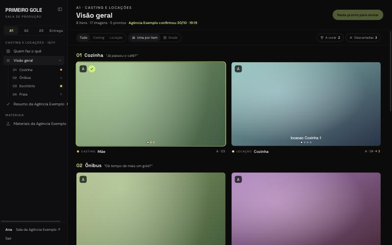
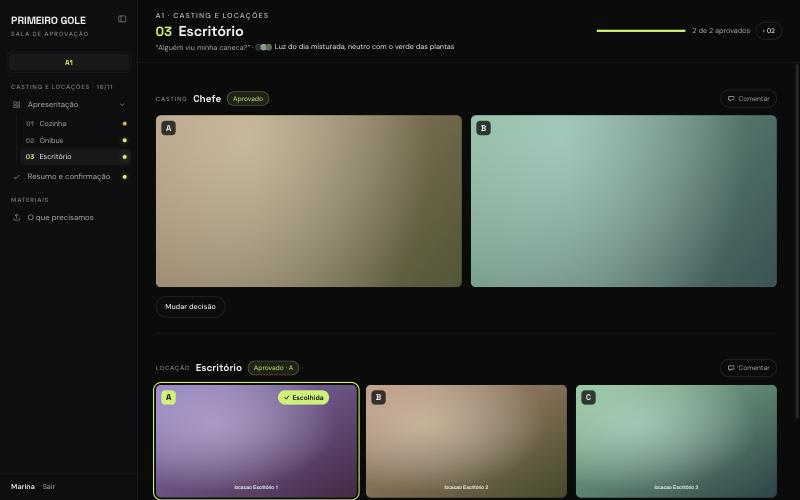

# Sala de aprovação

Uma sala online para aprovar imagens e vídeos com o cliente: casting, locações, looks, planos. Feita para filmes com IA, serve para qualquer job visual que anda em rodadas.

**Um app, duas salas:**

- **`/producao`**: o time sobe as opções, cura, divide quem faz o quê e envia a rodada.
- **`/aprovacao`**: o cliente escolhe, aprova ou pede ajuste, e confirma a rodada.

É um site estático (HTML e JavaScript puro, sem build) ligado ao [Supabase](https://supabase.com) (banco, login e arquivos). Tudo o que é do seu projeto fica em um arquivo só: [`sala/config.js`](sala/config.js).

| Sala de produção: visão geral | Sala de aprovação: uma cena |
| --- | --- |
|  |  |

<sub>Prints do projeto de exemplo, com imagens de teste. Troque por um print ou GIF do seu projeto.</sub>

## O que ela faz

- **Rodadas** (A1, A2, A3, Entrega) com prazo, **cenas** e **itens** (casting, locação, look…), cada item com suas opções A, B, C.
- **Quem faz o quê:** um quadro por pessoa do time; arraste os cards para trocar o dono.
- **Visão geral, imagem primeiro:** uma imagem grande por item (setas para ver as outras) ou a **grade**, com todas as opções lado a lado. Filtros por tipo, "A curar" e "Descartadas".
- **Curadoria do time:** em cada opção, ✓ Manter, ↻ Refazer ou ✕ Descartar, com nota e autor. Atalhos `M`, `R`, `D` no detalhe.
- **Detalhe da opção:** imagem grande com um painel que recolhe (`I`): legenda (o cliente vê), "por que esta opção", prompt e modelo.
- **Upload** por clique, arrastando ou colando (`⌘V`). A sala gera no navegador uma prévia (1920 px) e uma miniatura (480 px); o original fica para baixar.
- **Comentários** por item, e o pedido de ajuste do cliente vira um comentário.
- **Materiais:** o que o time pede ao cliente (fotos, vozes, logos), com envio dos dois lados e download em `.zip`.
- **Sem surpresas:** a sala se atualiza sozinha a cada 15 s, avisa quando há versão nova publicada e, se a sessão cair, pede a senha de novo.

## Como anda uma rodada

1. **Time:** em cada cena, **Novo item**, depois sobe as opções (arraste para o card).
2. **Cura:** ✓ nas que valem, ✕ nas que não valem. A regra:
   - se um item tem alguma opção com ✓, o cliente vê **só as com ✓**;
   - se não tem nenhuma, vê **todas menos as descartadas**;
   - "A curar" mostra os itens que ainda têm mais de 3 opções.
3. **Pronto:** no `⋯` do item, Status → Pronto.
4. **Enviar:** o botão mostra ao cliente os itens prontos e abre a mensagem pronta para mandar no grupo.
5. **Cliente:** clica na imagem para escolher (A, B ou C), aprova ou pede ajuste com um comentário e, no **Resumo**, confirma a rodada.
6. **Time:** vê "aprovou B", "pediu ajuste" e "confirmou" em cada item e na visão geral.

No `⋯` de cada item também dá para trocar entre **Escolhe uma** e **Aprova o conjunto** (o cliente aprova todas as opções como uma coisa só), mostrar ou esconder só aquele item e reabrir uma decisão.

## Instalação

Leva uns 15 minutos. Você precisa de uma conta no Supabase (o plano grátis serve) e de um lugar para publicar arquivos estáticos.

### 1. Banco (Supabase)

1. Crie um projeto em [supabase.com](https://supabase.com).
2. **SQL Editor → New query**: cole o conteúdo de [`supabase/schema.sql`](supabase/schema.sql) e clique em **Run**. Isso cria as tabelas, as regras de acesso, as funções e o bucket de arquivos.
3. **Authentication → Users → Add user → Create new user**: crie os dois logins, um do time e um do cliente (e-mail e senha, com **Auto Confirm User** marcado). Os e-mails não precisam existir de verdade.
4. Diga ao banco quem é quem. No **SQL Editor**, rode (com os seus e-mails):

   ```sql
   update auth.users set raw_app_meta_data = raw_app_meta_data || '{"side": "time"}' where email = 'time@exemplo.com';
   update auth.users set raw_app_meta_data = raw_app_meta_data || '{"side": "cliente"}' where email = 'cliente@exemplo.com';
   ```

5. Recomendado: em **Authentication → Sign In / Providers**, desligue **Allow new users to sign up**. Mesmo ligado, quem se cadastrar por fora não vê nada, mas não há motivo para deixar aberto.
6. Copie a **Project URL** (em **Project Settings → Data API**, ou no botão **Connect**) e a chave **anon** (em **Project Settings → API Keys**, aba *Legacy API Keys* se aparecer).

### 2. Config

Abra [`sala/config.js`](sala/config.js) e preencha:

- `SUPABASE_URL` e `SUPABASE_KEY`: o que você copiou no passo 6;
- `LOGINS`: os mesmos dois e-mails do passo 3;
- o resto do projeto (nome, cliente, time, cenas, rodadas): veja [Personalizar](#personalizar).

A chave anon foi feita para ir para o navegador: quem decide o que cada lado vê são as regras do banco.

### 3. Testar no seu computador

Na pasta do projeto:

```bash
python3 -m http.server 8000
```

Abra `http://localhost:8000/producao/` e entre com a senha do time. Na primeira entrada, a sala cria no banco as rodadas do config. A sala do cliente fica em `http://localhost:8000/aprovacao/`.

### 4. Publicar

Qualquer hospedagem de arquivos estáticos serve. Suba a pasta inteira, sem build:

- **Vercel:** `npx vercel deploy --prod` dentro da pasta.
- **Netlify:** arraste a pasta em [app.netlify.com/drop](https://app.netlify.com/drop).
- **GitHub Pages:** Settings → Pages → Deploy from a branch → `main` / `root`. Funciona também em subpasta (`usuario.github.io/sala-de-aprovacao/`).

Depois mande ao cliente o endereço que termina em `/aprovacao/` e a senha do login dele. O time usa `/producao/`. A raiz do site leva para a sala do cliente.

## Personalizar

Tudo em [`sala/config.js`](sala/config.js), com comentários:

| O quê | Onde | Exemplo |
| --- | --- | --- |
| Nome do projeto e texto do logo | `PROJECT.name`, `PROJECT.logo` | "Primeiro Gole" |
| Nome do cliente, com o artigo certo | `PROJECT.client`, `PROJECT.clientArticle` | "a Agência Exemplo", "da", "à" |
| Como o time assina os comentários | `PROJECT.studio` | "Estúdio Exemplo" |
| Cor de destaque | `PROJECT.accent` | `#C8F169` (use uma cor clara) |
| Rodapé do login, fuso das datas | `PROJECT.footer`, `PROJECT.timeZone` | |
| Os dois e-mails de login | `LOGINS` | |
| Pessoas do time | `PEOPLE` | `{ ana: "Ana", bruno: "Bruno" }` |
| Tipos de item e os dois com coluna própria | `KINDS`, `MAIN_KINDS` | casting à esquerda, locação à direita |
| Rodadas, prazos e texto de capa | `ROUNDS` | A1, A2, A3, Entrega |
| Cenas, falas e looks (paleta e prompt) | `SCENES` | `{ name: "Cozinha", line: "Já passou o café?" }` |
| Base de prompt e modelos por direção | `STYLE_BASE`, `PROMPTS` | |
| Mensagem de envio para o cliente | `SEND_MESSAGE` | `{rodada}`, `{link}`, `{itens}` |

As chaves de `PEOPLE` e `KINDS` são o que fica salvo no banco. Se você mudar uma chave com o projeto andando, os itens antigos ficam com a chave velha.

O visual (cores neutras, fontes, espaçamentos) está em [`sala/style.css`](sala/style.css), com as cores no topo.

### Campos extras

Algumas colunas não têm tela de edição e são preenchidas pelo **Table Editor** do Supabase ou por um script seu:

- `options.prompt` e `options.model`: aparecem no detalhe da opção, com o botão "Copiar prompt".
- `items.variants`: as direções de um item (`{"A": "uma mulher de 40 anos, cabelo cacheado", "B": "..."}`). Viram os botões 1, 2… em `⋯ → Prompts`, montados com os modelos de `PROMPTS`.
- `items.refs`: ids de arquivos de **Materiais**. Fotos ativam o **Comparar** (gerado lado a lado com a foto original); áudios tocam ao lado das opções.

## Segurança

- Cada lado tem **um login compartilhado**: as pessoas digitam só a senha. Quem é quem fica no nome que cada um escolhe ao entrar (assina comentários, escolhas e envios).
- O acesso é decidido no banco (RLS) pelo `app_metadata.side` do login, que o usuário não consegue alterar. O cliente nunca recebe itens não enviados, opções descartadas (ou sem ✓ quando o item tem alguma com ✓) nem as avaliações e notas do time.
- Os campos de uma opção que o cliente pode ver (legenda, prompt, "por que esta opção") a sala só mostra ao time, mas chegam ao navegador do cliente. Não escreva ali o que o cliente não pode ler.
- Os arquivos ficam num bucket privado e abrem por links assinados que valem 12 horas.
- **Sair** desconecta só aquele navegador. Como todo mundo de um lado usa o mesmo login, sair de todos os lugares derrubaria os colegas.
- Para trocar uma senha, rode no **SQL Editor**:

  ```sql
  update auth.users set encrypted_password = extensions.crypt('nova-senha', extensions.gen_salt('bf')) where email = 'cliente@exemplo.com';
  ```

## Estrutura

```
index.html             leva para aprovacao/
producao/index.html    sala do time (data-side="time")
aprovacao/index.html   sala do cliente (data-side="cliente")
sala/config.js         tudo do seu projeto
sala/app.js            o app, igual para todo projeto
sala/style.css         o visual
supabase/schema.sql    banco, regras de acesso, funções e bucket
```

O app usa o `supabase-js` 2.45.4 direto do jsDelivr e o JSZip do cdnjs (só quando alguém baixa um `.zip`). Não tem `npm install`.

## Licença

[MIT](LICENSE). Use, copie e adapte à vontade.
